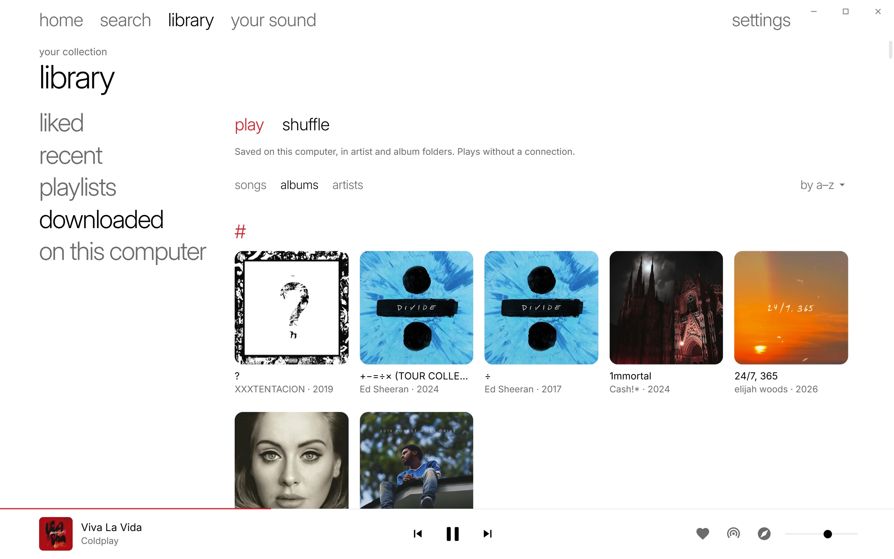

<div align="center">

# Verza

### A music player for Windows and Linux

YouTube Music without the ads, downloads in lossless, lyrics in time,<br/>
and one accent colour taken from the cover of whatever is playing.

<p>
  <a href="../../releases/latest"></a>
  
  
</p>

### **[Download Verza](../../releases/latest)** · **[Website](https://sambuddharoy.github.io/Verza-Next-releases/)** · **[Verza for Android](https://github.com/SambuddhaRoy/Verza)**

<br/>




</div>

> **Not affiliated with YouTube or Google.** Verza is one person's project, for personal use. It plays
> music through YouTube's own endpoints, bundles no music, ships no API keys, and has no server of its own.

---

## Install

**Windows 10 or 11 (64-bit).** Download `VerzaNext_x.y.z_x64-setup.exe` from the **[latest release](../../releases/latest)** and run it, or:

```
winget install SambuddhaRoy.VerzaNext
```

Windows will probably show a blue *"Windows protected your PC"* screen, because the installer isn't code-signed. Choose **More info**, then **Run anyway**.

**Linux.** The release has a `.deb` and an AppImage. Signing in needs Edge, Chrome, Chromium or Brave installed.

Then open Verza and either **sign in** to YouTube Music, so your likes, playlists and Home come with you, or **skip** it. Everything except your account's library works without signing in.

Verza updates itself: it checks when it starts and every few hours while it's open.

---

## What it does

- **Plays the whole YouTube Music catalogue**, full length, without ads, signed in or not.
- **Opens Spotify and Apple Music links.** Paste a playlist, album or song and it opens as a playlist, with its cover. Like it and it stays in your Library.
- **Downloads in lossless.** Turn it on and a download becomes a FLAC from Soulseek, the highest resolution on offer. Verza makes the account for you. Otherwise it saves M4A or MP3, filed by artist and album.
- **Lyrics** that follow the song, line by line.
- **Home made from what you play**: recently played, on repeat, forgotten favourites, and mixes built on your machine. **Discovery radio** finds artists you haven't heard.
- **Your Sound** names your genre and plays it.
- **Flick it over.** With Verza on your phone, flick toward your screen and the song carries on here, queue and all.
- **The music you already have**: your Music folder sits in the Library and plays in the same queue.
- A ten-band **equaliser**, fades between songs, volume normalisation, output device, sleep timer, media keys, the tray, and a light and a dark theme.

---

## FAQ

<details>
<summary><b>Is it safe? Why does Windows warn me?</b></summary>
<br/>

The installer isn't code-signed (the certificates cost hundreds a year), so SmartScreen warns about it. Choose **More info**, then **Run anyway**. Verza talks to no server of its own.
</details>

<details>
<summary><b>Do I need a YouTube account?</b></summary>
<br/>

No. Playback, search, radio, lyrics and downloads all work signed out. Signing in adds your YouTube Music library, and a like in Verza becomes a like on your account.
</details>

<details>
<summary><b>Where is my data stored?</b></summary>
<br/>

On your computer, in `~/.verza` (`%USERPROFILE%\.verza` on Windows). Downloads go to your Music folder. If you sign in, the login stays on your machine and is never in a backup or export.
</details>

<details>
<summary><b>Why do the files and the winget package say "VerzaNext"?</b></summary>
<br/>

It was called Verza Next while it replaced the first desktop Verza. Renaming the installer and the package would break updates for everyone who already has it, so those keep the old name.
</details>

<details>
<summary><b>Is there a Mac build?</b></summary>
<br/>

Not yet. Windows and Linux today.
</details>

---

<div align="center">
<sub><b>Verza</b>, a personal project shared for personal use. Not affiliated with YouTube or Google.</sub>
</div>
