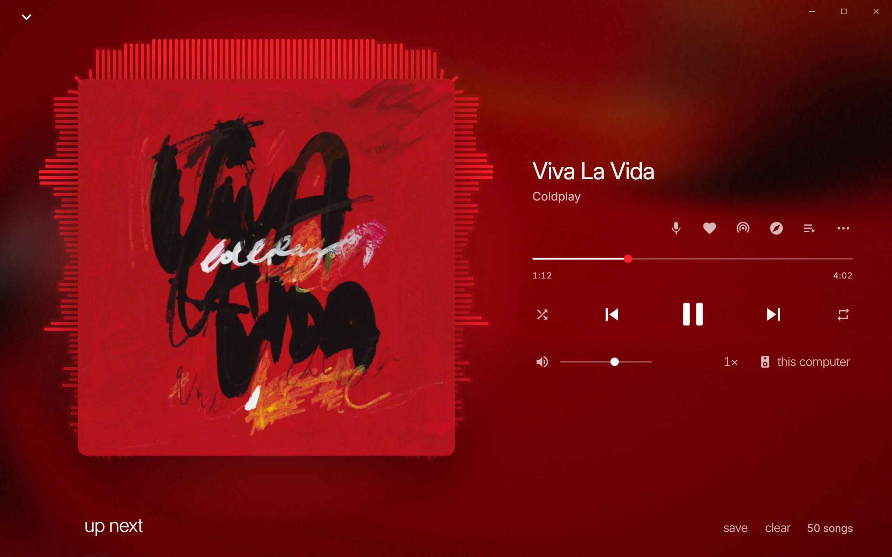
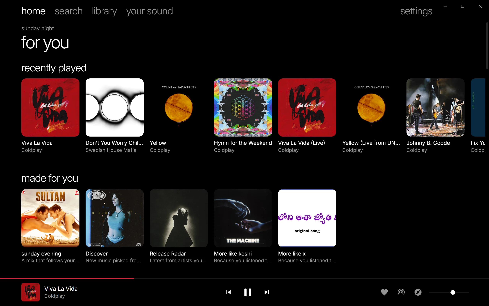
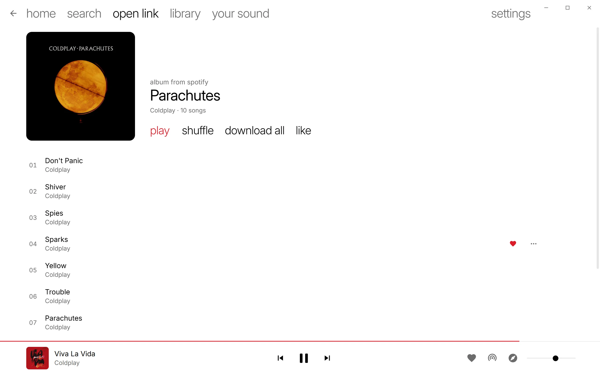
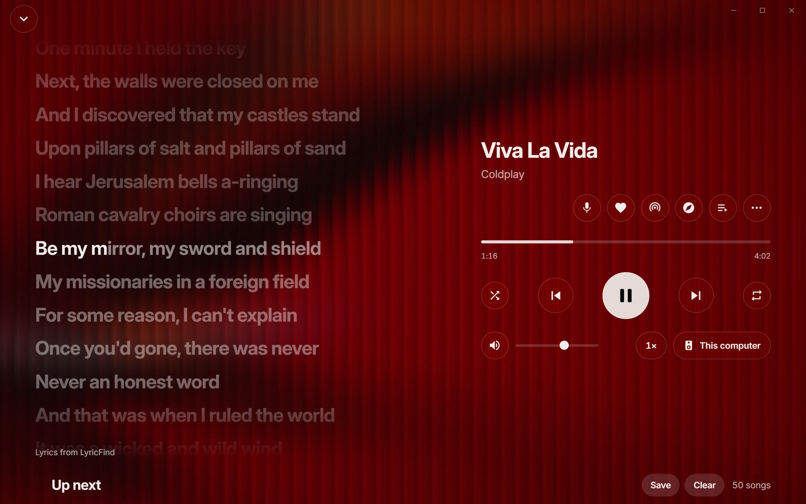

<div align="center">

# Verza

### A music player for Windows and Linux

All of YouTube Music. No ads.<br/>
3D covers, lossless downloads and lyrics in time.

<p>
  <a href="../../releases/latest"></a>
  
  
</p>

### **[Download Verza](../../releases/latest)** · **[Website](https://sambuddharoy.github.io/Verza-Next-releases/)** · **[Verza for Android](https://github.com/SambuddhaRoy/Verza)**

<br/>









</div>

> **Not affiliated with YouTube or Google.** Verza is an independent project for personal use. It ships
> no music and has no servers of its own.

---

## Install

**Windows 10 or 11 (64-bit).** Download `VerzaNext_x.y.z_x64-setup.exe` from the **[latest release](../../releases/latest)** and run it, or:

```
winget install SambuddhaRoy.VerzaNext
```

Windows will probably show a blue *"Windows protected your PC"* screen, because the installer isn't code-signed. Choose **More info**, then **Run anyway**.

**Linux.** The release has a `.deb` and an AppImage. Signing in needs Edge, Chrome, Chromium or Brave installed.

Then open Verza. **Sign in** to bring your likes, playlists and Home, or **skip** it. Everything else works either way.

Verza keeps itself up to date.

---

## What it does

- **No ads.** All of YouTube Music, full length, signed in or not.
- **3D covers.** Move your pointer over Now Playing and the cover moves in 3D. Windows only for now.
- **Lossless downloads.** Save songs as FLAC, as good as the original recording.
- **Lyrics in time.** Follow along, line by line.
- **Made for you.** Home, mixes and Discovery radio, built from what you play.
- **Your Sound.** See what you listen to, and get a radio of your genre.
- **Spotify and Apple Music links.** Paste one and it opens as a playlist.
- **Flick it over.** Flick your phone toward your screen and the song moves here.
- **Your own music.** Files in your Music folder play right alongside everything else.
- **And more.** A ten-band equaliser, crossfade, sleep timer, media keys, and two themes: black and stone.

---

## FAQ

<details>
<summary><b>Is it safe? Why does Windows warn me?</b></summary>
<br/>

The installer isn't code-signed yet, so Windows warns about it. Choose **More info**, then **Run anyway**. Verza has no servers of its own.
</details>

<details>
<summary><b>Do I need a YouTube account?</b></summary>
<br/>

No. Playing, search, radio, lyrics and downloads all work without one. Sign in to add your YouTube Music library.
</details>

<details>
<summary><b>Where is my data stored?</b></summary>
<br/>

On your computer, in `~/.verza` (`%USERPROFILE%\.verza` on Windows). Downloads go to your Music folder. If you sign in, the login stays on your machine and is never in a backup or export.
</details>

<details>
<summary><b>Why do the files and the winget package say "VerzaNext"?</b></summary>
<br/>

It was called Verza Next while it replaced the first desktop Verza. Renaming the installer and the package would break updates for everyone who already has it, so those keep the old name.
</details>

<details>
<summary><b>Is there a Mac build?</b></summary>
<br/>

Not yet. Windows and Linux today.
</details>

---

<div align="center">
<sub><b>Verza</b>, an independent project for personal use. Not affiliated with YouTube or Google.</sub>
</div>
